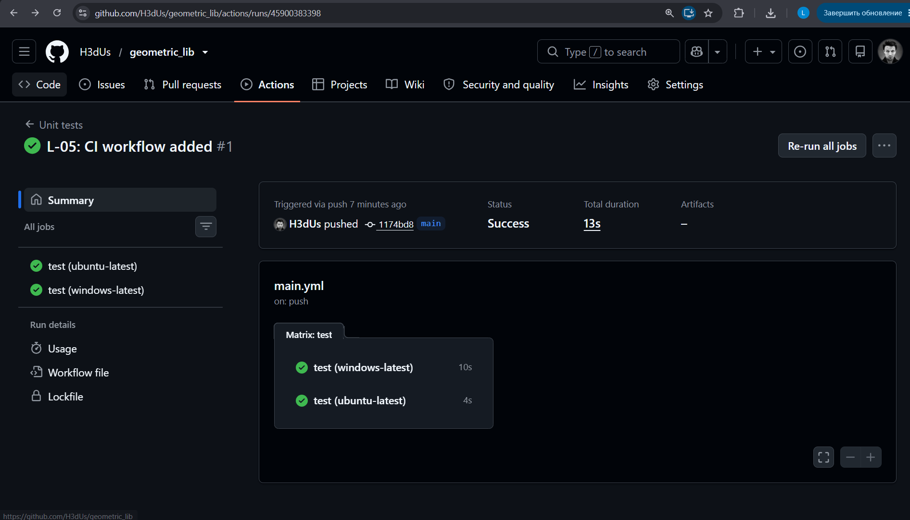
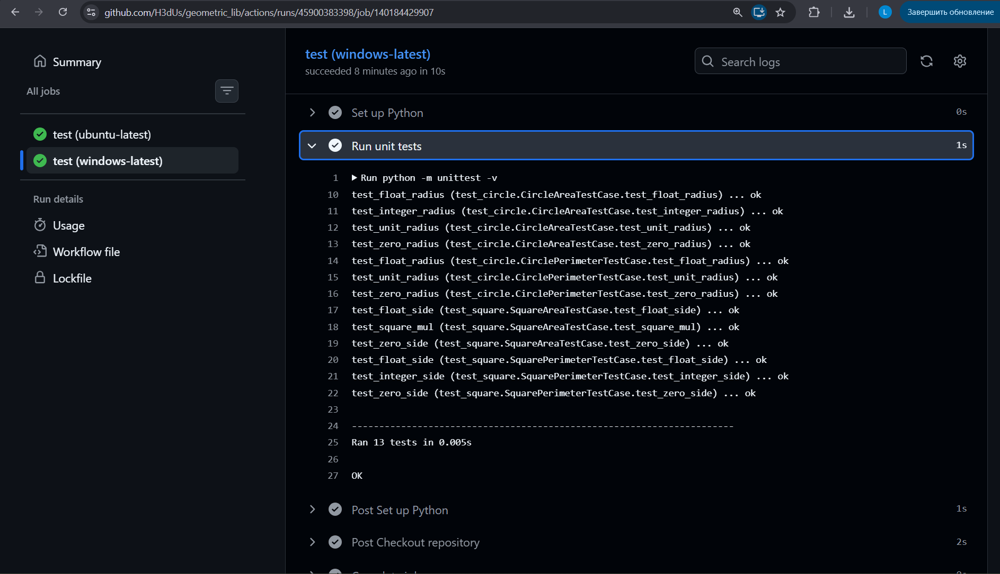

# Непрерывная интеграция (CI) в Geometric Lib

## Задание

Добавить в проект с помощью механизма GitHub Actions workflow-файл `main.yml`,
который после каждой операции push запускает unit-тесты, созданные в лабораторной
работе №4. Тесты должны выполняться на двух встроенных runner'ах:
`ubuntu-latest` и `windows-latest`.

## Что такое CI и GitHub Actions

**CI (Continuous Integration, непрерывная интеграция)** — практика, при которой
каждое изменение кода, отправленное в репозиторий, автоматически собирается
и проверяется тестами. Это позволяет обнаружить ошибку сразу после её появления,
а не при ручной проверке спустя время.

**GitHub Actions** — встроенная в GitHub система автоматизации. Сценарий
автоматизации (workflow) описывается в YAML-файле в каталоге `.github/workflows/`
репозитория. Workflow запускается по событию (например, push), состоит из
заданий (jobs), каждое задание выполняется на отдельной виртуальной машине
(runner) и состоит из последовательных шагов (steps).

## Workflow-файл

Файл `.github/workflows/main.yml`:

```yaml
name: Unit tests

on: [push]

jobs:
  test:
    strategy:
      matrix:
        os: [ubuntu-latest, windows-latest]
    runs-on: ${{ matrix.os }}

    steps:
      - name: Checkout repository
        uses: actions/checkout@v6

      - name: Set up Python
        uses: actions/setup-python@v6
        with:
          python-version: '3.x'

      - name: Run unit tests
        run: python -m unittest -v
```

### Разбор файла

| Элемент                          | Назначение                                                                 |
|----------------------------------|----------------------------------------------------------------------------|
| `name: Unit tests`               | Имя workflow, отображается на вкладке Actions                             |
| `on: [push]`                     | Событие запуска — каждый push в любую ветку репозитория                    |
| `jobs.test`                      | Задание, выполняющее тестирование                                          |
| `strategy.matrix.os`             | Матрица: задание запускается отдельно для каждой ОС из списка             |
| `runs-on: ${{ matrix.os }}`      | Runner, на котором выполняется задание (подставляется значение из матрицы) |
| `actions/checkout@v6`            | Скачивает код репозитория на runner                                        |
| `actions/setup-python@v6`        | Устанавливает последнюю версию Python 3                                    |
| `python -m unittest -v`          | Находит все файлы `test_*.py` и запускает тесты с подробным выводом        |

Благодаря матрице одно описание задания порождает два параллельных запуска:
`test (ubuntu-latest)` и `test (windows-latest)`. Так проверяется, что библиотека
работает одинаково в Linux и Windows.

## Результаты

После push коммита с workflow-файлом GitHub Actions автоматически запустил
оба задания. Оба завершились успешно.

Сводка запуска — оба задания выполнены успешно:



Лог шага `Run unit tests` на runner'е `windows-latest` — все 13 тестов пройдены:



## Вывод

В проект добавлен workflow GitHub Actions, который после каждого push автоматически
запускает unit-тесты на двух операционных системах (Ubuntu и Windows). Все тесты
проходят на обоих runner'ах. Теперь ошибка, внесённая в код, будет обнаружена
автоматически сразу после отправки изменений в репозиторий, а результат проверки
виден на вкладке Actions и рядом с каждым коммитом (зелёная галочка или красный
крестик).
