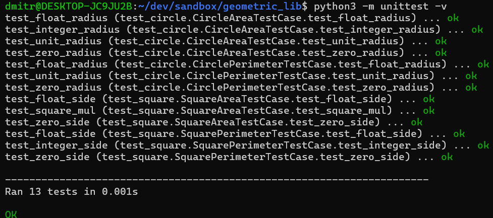
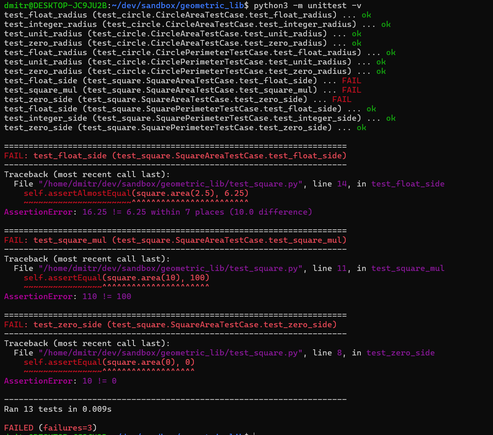

# План тестирования Geometric Lib

## 1. Цели и задачи тестирования

**Цель** — убедиться, что функции библиотеки Geometric Lib правильно вычисляют площадь
и периметр фигур, и получить набор автоматических проверок, который позволит быстро
обнаруживать ошибки при дальнейших изменениях кода (регрессионное тестирование).

**Задачи:**

- определить функции, подлежащие тестированию, и допустимые для них входные данные;
- составить наборы входных данных, включая граничные значения;
- вручную вычислить ожидаемые результаты для каждого набора;
- реализовать автоматические unit-тесты с помощью модуля `unittest`;
- выполнить тесты, зафиксировать результаты и убедиться, что тесты обнаруживают
  внесённую ошибку.

## 2. Описание тестируемого продукта

Geometric Lib — библиотека на Python для вычисления площади и периметра простых
геометрических фигур. Каждая фигура описана в отдельном модуле:

| Модуль      | Функция        | Формула     | Вход                   | Выход        |
|-------------|----------------|-------------|------------------------|--------------|
| `circle.py` | `area(r)`      | S = πr²     | радиус `r >= 0`        | float        |
| `circle.py` | `perimeter(r)` | P = 2πr     | радиус `r >= 0`        | float        |
| `square.py` | `area(a)`      | S = a²      | сторона `a >= 0`       | int \| float |
| `square.py` | `perimeter(a)` | P = 4a      | сторона `a >= 0`       | int \| float |

Требования к продукту: функции принимают целые и дробные неотрицательные числа
и возвращают значение, вычисленное по указанной формуле. Функции не имеют побочных
эффектов и не зависят друг от друга, поэтому каждая может тестироваться изолированно.

## 3. Область тестирования

**Тестируются:**

- `circle.area(r)` и `circle.perimeter(r)`;
- `square.area(a)` и `square.perimeter(a)`.

**Не тестируются:**

- отрицательные и нечисловые входные данные: функции не содержат проверки входа,
  а документация допускает только значения `>= 0`, поэтому поведение на таких данных
  не определено требованиями;
- производительность: функции выполняют одну арифметическую операцию за константное время;
- безопасность и пользовательский интерфейс: библиотека не работает с внешними данными
  и не имеет интерфейса.

## 4. Стратегия тестирования

- **Вид тестирования:** функциональное модульное (unit) тестирование.
- **Подход:** «чёрный ящик» — тесты проверяют соответствие результата формуле,
  не опираясь на внутреннюю реализацию функций.
- **Инструмент:** стандартный модуль Python `unittest`. Тесты оформлены в классах,
  наследуемых от `unittest.TestCase`, имена тестовых методов начинаются с `test`.
  Тесты вынесены в отдельные файлы `test_circle.py` и `test_square.py`.
- **Выбор входных данных:**
  - граничное значение — `0` (результат должен быть равен 0);
  - эталонное значение — `1` (для круга результат выражается через π напрямую);
  - обычные целые значения (`3`, `4`, `10`);
  - дробные значения (`0.5`, `2.5`).
- **Способ сравнения:** для целочисленных результатов используется `assertEqual`.
  Для результатов с числом π и дробными числами используется `assertAlmostEqual`
  (сравнение с точностью до 7 знаков после запятой), так как числа с плавающей точкой
  хранятся в памяти приближённо и строгое сравнение может дать ложную ошибку.
- **Запуск:** вручную командой `python3 -m unittest -v` из корня проекта.
  В дальнейшем (лабораторная работа №5) тесты запускаются автоматически
  в GitHub Actions после каждого push.

### Тест-кейсы

| № | Тест                                            | Вход  | Ожидаемый результат |
|---|-------------------------------------------------|-------|---------------------|
| 1 | `CircleAreaTestCase.test_zero_radius`           | 0     | 0                   |
| 2 | `CircleAreaTestCase.test_unit_radius`           | 1     | π                   |
| 3 | `CircleAreaTestCase.test_integer_radius`        | 3     | 9π                  |
| 4 | `CircleAreaTestCase.test_float_radius`          | 0.5   | 0.25π               |
| 5 | `CirclePerimeterTestCase.test_zero_radius`      | 0     | 0                   |
| 6 | `CirclePerimeterTestCase.test_unit_radius`      | 1     | 2π                  |
| 7 | `CirclePerimeterTestCase.test_float_radius`     | 2.5   | 5π                  |
| 8 | `SquareAreaTestCase.test_zero_side`             | 0     | 0                   |
| 9 | `SquareAreaTestCase.test_square_mul`            | 10    | 100                 |
| 10| `SquareAreaTestCase.test_float_side`            | 2.5   | 6.25                |
| 11| `SquarePerimeterTestCase.test_zero_side`        | 0     | 0                   |
| 12| `SquarePerimeterTestCase.test_integer_side`     | 4     | 16                  |
| 13| `SquarePerimeterTestCase.test_float_side`       | 2.5   | 10                  |

## 5. Критерии приёмки

Тестирование считается успешно завершённым, а продукт — принятым, если:

- все 13 тестов выполняются без ошибок (`unittest` выводит `OK`);
- каждая из четырёх функций покрыта как минимум граничным (0), целым и дробным случаем
  (для `circle.perimeter` — граничным, эталонным и дробным);
- при намеренном внесении ошибки в функцию соответствующие тесты падают (`FAIL`);
- исходный код тестов размещён в публичном репозитории GitHub, а факт их появления
  отражён в истории изменений документации (`docs/README.md`).

## 6. Ожидаемые результаты

- Отчёт `unittest` об успешном прохождении всех тестов: `Ran 13 tests ... OK`.
- При наличии дефекта — отчёт со статусом `FAILED`, в котором указаны упавший тест,
  строка с проверкой и расхождение значений (например, `AssertionError: 110 != 100`).
- Метрики: количество выполненных, пройденных и упавших тестов.

### Фактические результаты

Успешный прогон всех тестов:

Прогон с намеренно внесённой ошибкой в `square.area` (`return a * a + 10`):
упали три теста площади квадрата, остальные прошли — тесты обнаруживают дефект.

После отката ошибки (`git restore square.py`) все 13 тестов снова проходят.
